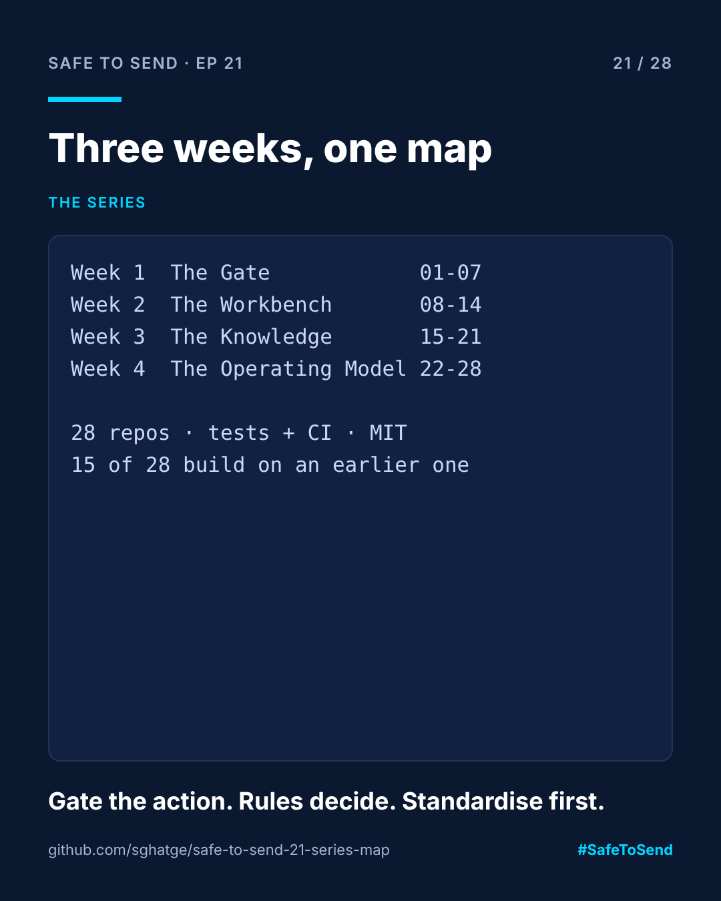

# safe-to-send-21 · The Series Map



**Safe to Send · Episode 21** — Week 3 retrospective of a 28-day learn-in-public series on governing AI in CRM operations.

> Three weeks, twenty-one repos, one idea: in CRM, AI needs guardrails, tests and shared standards before it needs more autonomy.

This repo is the index for the whole series. **Start with [SERIES.md](SERIES.md)**: every episode, its repo, and a diagram of which episode builds on which.

## Why a map repo

Twenty-eight small repos are easy to start and hard to navigate. One registry file (`registry.json`) is the single source of truth. `build_map.py` validates it (every episode present, no episode depending on a later one, repo names match numbers) and regenerates `SERIES.md` with a Mermaid dependency diagram GitHub renders on its own.

## Run it

```bash
python build_map.py
```

```
SERIES.md written: 28 episodes, 15 build on an earlier one
```

## The three ideas the series keeps coming back to

1. **Gate the action, not the prompt.** Episodes 01–07, 13 and 16.
2. **Rules decide, models explain, tests prove it.** Episodes 08–12.
3. **Standardise before you automate.** Episodes 15, 17, 18 and 20.

MIT · [Sangram Ghatge](https://www.linkedin.com/in/sangram-g-2369705b) · #SafeToSend
