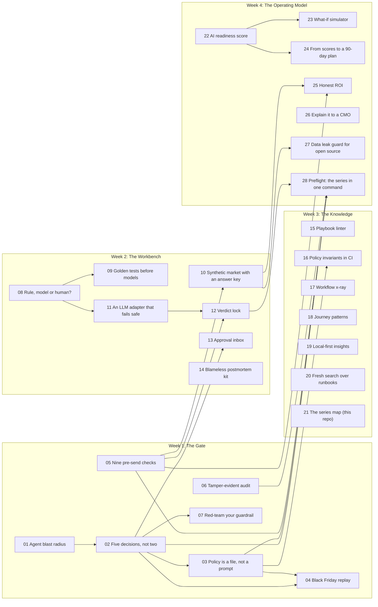

# Safe to Send: all 28 repos

28 days of governing AI in CRM operations.

## Week 1: The Gate

| Ep | Repo | What it shows |
|---|---|---|
| 01 | [safe-to-send-01-agent-blast-radius](https://github.com/sghatge/safe-to-send-01-agent-blast-radius) | Agent blast radius |
| 02 | [safe-to-send-02-five-decisions](https://github.com/sghatge/safe-to-send-02-five-decisions) | Five decisions, not two |
| 03 | [safe-to-send-03-policy-as-code](https://github.com/sghatge/safe-to-send-03-policy-as-code) | Policy is a file, not a prompt |
| 04 | [safe-to-send-04-black-friday-replay](https://github.com/sghatge/safe-to-send-04-black-friday-replay) | Black Friday replay |
| 05 | [safe-to-send-05-presend-qa](https://github.com/sghatge/safe-to-send-05-presend-qa) | Nine pre-send checks |
| 06 | [safe-to-send-06-audit-chain](https://github.com/sghatge/safe-to-send-06-audit-chain) | Tamper-evident audit |
| 07 | [safe-to-send-07-red-team-your-guardrail](https://github.com/sghatge/safe-to-send-07-red-team-your-guardrail) | Red-team your guardrail |

## Week 2: The Workbench

| Ep | Repo | What it shows |
|---|---|---|
| 08 | [safe-to-send-08-rule-model-or-human](https://github.com/sghatge/safe-to-send-08-rule-model-or-human) | Rule, model or human? |
| 09 | [safe-to-send-09-golden-tests](https://github.com/sghatge/safe-to-send-09-golden-tests) | Golden tests before models |
| 10 | [safe-to-send-10-synthetic-market](https://github.com/sghatge/safe-to-send-10-synthetic-market) | Synthetic market with an answer key |
| 11 | [safe-to-send-11-llm-adapter](https://github.com/sghatge/safe-to-send-11-llm-adapter) | An LLM adapter that fails safe |
| 12 | [safe-to-send-12-verdict-lock](https://github.com/sghatge/safe-to-send-12-verdict-lock) | Verdict lock |
| 13 | [safe-to-send-13-approval-inbox](https://github.com/sghatge/safe-to-send-13-approval-inbox) | Approval inbox |
| 14 | [safe-to-send-14-blameless-postmortem](https://github.com/sghatge/safe-to-send-14-blameless-postmortem) | Blameless postmortem kit |

## Week 3: The Knowledge

| Ep | Repo | What it shows |
|---|---|---|
| 15 | [safe-to-send-15-playbook-linter](https://github.com/sghatge/safe-to-send-15-playbook-linter) | Playbook linter |
| 16 | [safe-to-send-16-policy-invariants-ci](https://github.com/sghatge/safe-to-send-16-policy-invariants-ci) | Policy invariants in CI |
| 17 | [safe-to-send-17-workflow-xray](https://github.com/sghatge/safe-to-send-17-workflow-xray) | Workflow x-ray |
| 18 | [safe-to-send-18-journey-patterns](https://github.com/sghatge/safe-to-send-18-journey-patterns) | Journey patterns |
| 19 | [safe-to-send-19-local-first-insights](https://github.com/sghatge/safe-to-send-19-local-first-insights) | Local-first insights |
| 20 | [safe-to-send-20-fresh-search](https://github.com/sghatge/safe-to-send-20-fresh-search) | Fresh search over runbooks |
| 21 | [safe-to-send-21-series-map](https://github.com/sghatge/safe-to-send-21-series-map) | The series map (this repo) |

## Week 4: The Operating Model

| Ep | Repo | What it shows |
|---|---|---|
| 22 | [safe-to-send-22-readiness-score](https://github.com/sghatge/safe-to-send-22-readiness-score) | AI readiness score |
| 23 | [safe-to-send-23-what-if-simulator](https://github.com/sghatge/safe-to-send-23-what-if-simulator) | What-if simulator |
| 24 | [safe-to-send-24-team-roadmap](https://github.com/sghatge/safe-to-send-24-team-roadmap) | From scores to a 90-day plan |
| 25 | [safe-to-send-25-honest-roi](https://github.com/sghatge/safe-to-send-25-honest-roi) | Honest ROI |
| 26 | [safe-to-send-26-cmo-translator](https://github.com/sghatge/safe-to-send-26-cmo-translator) | Explain it to a CMO |
| 27 | [safe-to-send-27-data-leak-guard](https://github.com/sghatge/safe-to-send-27-data-leak-guard) | Data leak guard for open source |
| 28 | [safe-to-send-28-preflight](https://github.com/sghatge/safe-to-send-28-preflight) | Preflight: the series in one command |

## How the episodes connect

## Foundations

- [acc-agent-gate](https://github.com/sghatge/acc-agent-gate): ACC Agent Gate: governance layer between AI agents and Adobe Campaign
- [ai-readiness-calculator](https://github.com/sghatge/ai-readiness-calculator): AI Readiness Calculator
- [crm-ai-agent-platform](https://github.com/sghatge/crm-ai-agent-platform): CRM AI Agent Platform (rules-first workbench)
